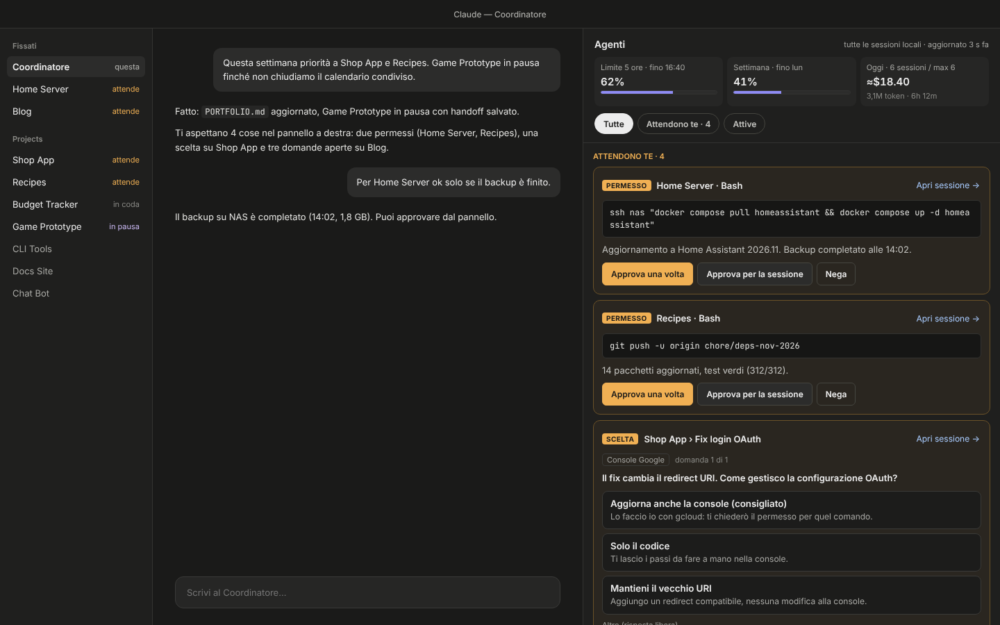
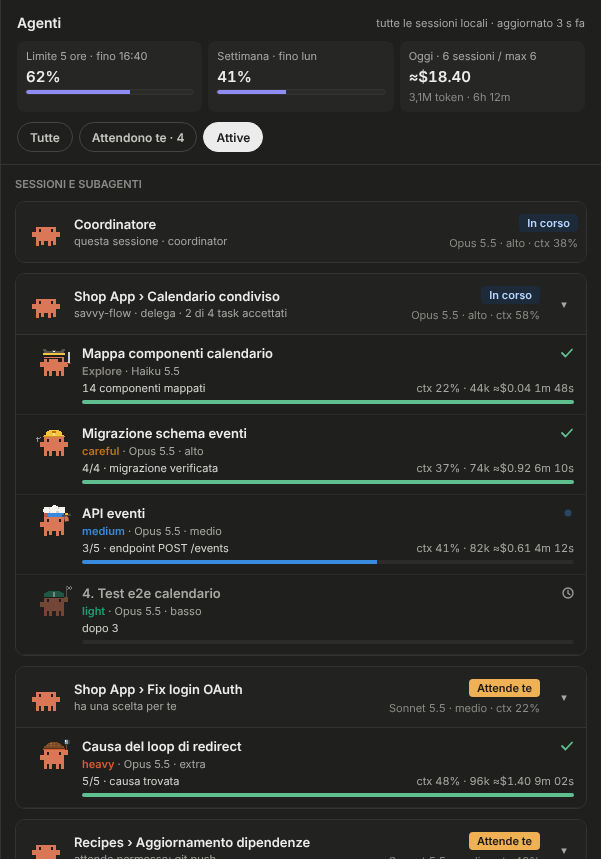
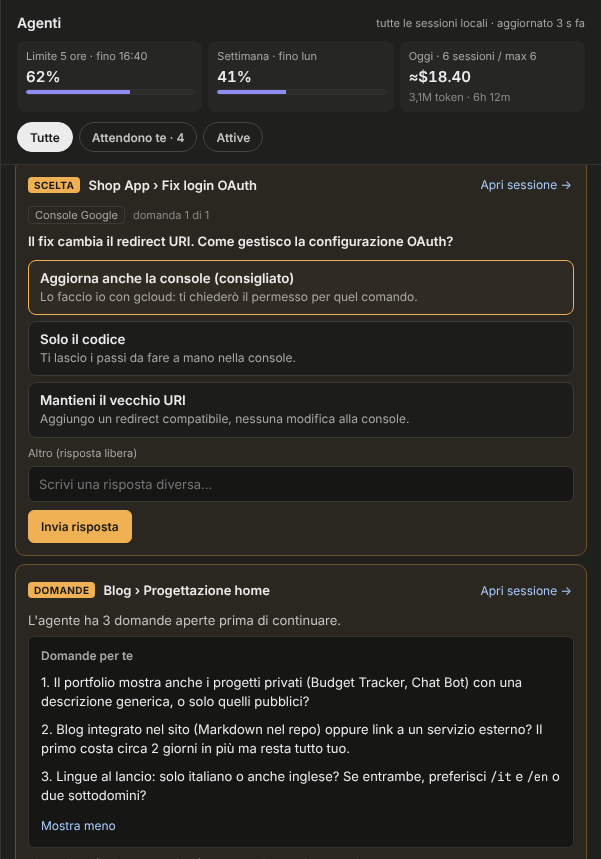

# coordinator-monitor

One pane for every local Claude Code session: what each one is doing, its subagents, and everything that waits for you (permissions and questions) answerable in place.

<p align="center">
  
</p>

<p align="center">
  <a href="https://buymeacoffee.com/easly1989"></a>
  <a href="https://paypal.me/carloruggiero"></a>
  <a href="https://buy.stripe.com/8x26oAeqA7h6dPk80hfbq00"></a>
  <a href="https://liberapay.com/amon2126/donate"></a>
  <a href="https://github.com/sponsors/easly1989"></a>
</p>

It is a Claude Code **mod** (function hooks, the early-access plugin API). Made for a "coordinator" workflow, where you talk to one session and it delegates to many, but useful as soon as you run more than one session at a time.

> Status: **0.5, early.** Built against Claude Code 2.1.316. The screenshots come from the design mockup, which the pane now follows; real ones will replace them once the pane has run on more machines. See the [changelog](CHANGELOG.md).

## What it does

- **Every local session in one place.** Each session that runs the mod publishes its status (state, model, effort, context, subagents) to a shared folder; the pane reads them all. Sessions show under their sidebar names, waiting ones first: the session's header on a shaded band, each subagent an inset row beneath it with its context, tokens and elapsed time. One whose subagents are still working counts as active. The coordinator itself is left out of the list (its chat is beside the pane), though anything it waits on still reaches the inbox.
- **Open any session.** The **Open** button on a session's card brings it up in the desktop app.
- **Each session's tasks and progress.** A session's card lists what it is doing and what it has planned, as its own task list has them (the desktop's plan, the CLI's todo list), plus what the coordinator queued for it; a bar shows its tasks done out of all it has to do. Reorder the planned ones with ▲ ▼ ⤒ (under the pointer on the desktop, always on the terminal): the session is told the new order. Nothing in the pane removes a task: ask the coordinator or the session. The list folds away per session.
- **Lock a session in place.** 🔒 on a session's card keeps it in a group at the top, in your order, so it stops moving as sessions start and stop working. Each session's crab wears a hat of its own, picked from its name.
- **savvy-flow aware.** With [savvy-flow](https://github.com/johnnyvizz/claude-kit/tree/main/plugins/savvy-flow) and [savvy-progress](https://github.com/johnnyvizz/claude-kit/tree/main/plugins/savvy-progress) installed, workers show up with their tier crab (astronaut, detective, engineer, chef, racer), model and effort, and the steps they report. Without them, any subagent is listed.
- **Protected commands wait for you.** Merges, pushes to `main`, deploys and service restarts never run without your approval, whatever the session's permission mode. While a coordinator runs, the command waits in its call for two minutes, as at a dialog: approved from the pane, it runs at once. Unanswered by then, the session is told to stop and wait, and your answer reaches it as a new message.
- **Large requests read at a glance.** A long shell command is split into its steps, with tags for what they can do (network, runs code, deletes, writes files); a file write shows its path and the code itself, an edit its diff. That view is only a reading aid, labelled as one, above the full request. The full request is always on the card, whole, with hidden characters drawn as codes, and it is what you approve. Where the split into steps is not certain, the aid shows no steps. Optionally (`explainRequests`), Haiku adds a sentence or two in plain words, labelled as unverified.
- **The app's permission prompts come to you too.** While a coordinator session is running, a session whose app would ask for a permission sends the ask to the pane and holds there, as it would at the dialog; approve it once, for the session, or deny it, and the session carries on. With no answer in nine minutes, or no coordinator running, the app's own dialog asks. The coordinator keeps its own dialog: you are in its chat.
- **Questions come to you.** A session's multiple-choice question (the dialog with options) is forwarded to the pane with every option and a free answer field. Open questions a session ends its turn with, under a `## Questions for you` heading, are shown too, with a reply box.
- **Reports come to you.** A session that ends its turn with a report and no questions section shows it in the inbox as one line, the whole report a click away, with a reply box. One that waits for your go-ahead (its desktop wrap-up asks, or its text asks for confirmation) is marked, and **Go ahead** answers it. **Mark as read** tells the session you read it, as a note it reads at its next request: no turn starts, and nothing answers it.
- **The coordinator hears every answer.** Whatever you answer in the pane except a dismissal, is also noted in the pane's own session, the coordinator. The note holds which session (its title, quoted), which request and what you said; nothing else the session wrote. It reads that at its next request, without a turn of its own.
- **Answered means gone.** A request leaves the pane as soon as you answer it; the owning session receives your answer as a new message and carries on. Answered in the session itself, it leaves too: questions, choices, reports and protected commands once you type in the session (not a slash command), an app permission once the call runs or the turn ends. A session's next closing message supersedes what it asked or reported before. Anything else you can dismiss.
- **Usage at a glance.** The 5-hour and weekly limits, as the latest session reported them.

<p align="center">
  
  
</p>

## Install

Requires Claude Code 2.1.316 or later (mods are early access and the API may change between releases).

**For every session, including the desktop app** — clone the repository and add its folder to `CLAUDE_CODE_PLUGIN_DIRS` in `~/.claude/settings.json`. If the variable already holds other folders (savvy-progress, say), append to it rather than replacing it. On Windows, prefer an absolute path (`C:/Users/you/coordinator-monitor`).

```bash
git clone https://github.com/easly1989/coordinator-monitor.git ~/coordinator-monitor
```

```json
{
  "env": {
    "CLAUDE_CODE_PLUGIN_DIRS": "~/coordinator-monitor"
  }
}
```

**For one session:**

```bash
claude --plugin-dir ~/coordinator-monitor
```

The mod has to run in **every** session you want to see: that is what publishes the session's status.

## Use

- `/agents-monitor` opens the pane in the current session.
- After updating the mod, run `/reload-plugins` in the coordinator: every other session sees the newer version and reloads itself once it is idle. A session still on an older copy is flagged on its card.
- Set **Coordinator folder** (`/config`, or `pluginConfigs` below) to the folder name of your coordinator session: the pane opens there by itself, and that session keeps its own questions instead of forwarding them.
- Click a subagent of the current session to open its transcript. **Open** on any other session's card brings that session up in the desktop app (its `claude://` deep link; the session must be one the desktop app started).
- Ask your sessions (in your `CLAUDE.md`) to end a turn that needs your input with a `## Questions for you` section, numbered. The Italian `## Domande per te` works too.

### Settings

The key under `pluginConfigs` is the mod's source id, which depends on how it is loaded: `coordinator-monitor` (or `coordinator-monitor@inline`) from `--plugin-dir` or `CLAUDE_CODE_PLUGIN_DIRS`, `coordinator-monitor@skills-dir` when it sits in `~/.claude/skills/`, `coordinator-monitor@<marketplace>` when installed. Under the wrong key the options are silently ignored and the defaults apply (the pane then never opens by itself).

```json
{
  "pluginConfigs": {
    "coordinator-monitor": {
      "options": {
        "language": "auto",
        "coordinatorFolder": "coordinator",
        "forwardQuestions": "on",
        "explainRequests": "off",
        "busDir": ""
      }
    }
  }
}
```

| Option | Default | What it does |
| --- | --- | --- |
| `language` | `auto` | `en` or `it`; `auto` follows Claude Code's `language` setting, then the locale. |
| `coordinatorFolder` | empty | Folder name of the coordinator session: the pane opens there by itself. |
| `forwardQuestions` | `on` | `off` keeps questions in their session's own dialog. |
| `explainRequests` | `off` | `on` asks Haiku for a short plain-language explanation of each large permission request (a small cost on your plan; written from the request itself, so it can be wrong or steered). |
| `busDir` | `~/.claude/coordinator-monitor` | The shared folder sessions publish to. |

### Protected commands

The defaults cover merges (`gh pr merge`, `git merge`, pushes to `main`/`master`, force pushes), deploys and releases (`vercel --prod`, `fly deploy`, `npm publish`, `kubectl apply`, `helm upgrade`, `terraform apply`, `gh release create`, `docker push`, …) and service restarts (`docker restart/stop`, `docker compose up/down/restart`, `systemctl restart`, `reboot`, Home Assistant `ha core restart`, Proxmox `pct`/`qm`), also when wrapped in `ssh host "…"`.

Add your own, or mark services as critical so their requests stand out, in `<busDir>/rules.json` (read when a session starts):

```json
{
  "replaceDefaults": false,
  "rules": [{ "label": "restart", "pattern": "\\bpm2\\s+restart\\b" }],
  "critical": ["jellyfin", "homeassistant"],
  "tierModels": { "light": "Haiku · low", "medium": "Sonnet · medium" },
  "hats": { "planora": "crown" }
}
```

`tierModels` relabels the savvy tiers when your copies of the savvy agents run other models than upstream. `hats` picks a session's hat by a word of its name: `tophat`, `beanie`, `beret`, `wizard`, `captain` or `crown`.

The coordinator session gets a tool, `queue`, to list, add or remove a session's planned tasks; the pane shows them as "from the coordinator". The mod writes them to `<busDir>/queues.json`.

The rules are a guard against a session doing something you wanted to supervise, not a sandbox: a command written to dodge a pattern is not caught. Keep your normal permission settings.

Answers are files the pane writes to `<busDir>/answers/`. A session that could write one could approve its own app permissions, and one that wrote `rules.json` or a status file could loosen the rules or pose as another session, so the mod refuses any tool call that would change `<busDir>`: a file tool aimed there, or a command that names it. Reading it stays allowed. That too is a guard, not a sandbox: every session runs as you, so a command that builds the path at run time is not caught. An app permission approved from the pane covers exactly what the card showed, the whole input; an input too long to show keeps the app's own dialog.

## How it works

```
session A ─┐  publishes  <busDir>/sessions/A.json  (every 3 s)
session B ─┤             <busDir>/sessions/B.json
session C ─┘             …
                 ▲ reads all                 │ writes
            the pane (any session) ──────► <busDir>/answers/B.json
                                             │ picked up by B on its next tick
                                             ▼
                          B receives your answer as a new message and goes on
```

Everything stays on your machine: plain JSON files, no server, no network. A session's closing message (its report) is written there too, so the pane can show it. A session that stops publishing for 15 minutes drops out of the pane; a closed one stays an hour, marked as ended.

## Credits

- The pixel crabs and their animations are adapted from [savvy-progress](https://github.com/johnnyvizz/claude-kit/tree/main/plugins/savvy-progress) by [johnnyvizz](https://github.com/johnnyvizz) (MIT; see [NOTICE](NOTICE)), and the tiers come from [savvy-flow](https://github.com/johnnyvizz/claude-kit/tree/main/plugins/savvy-flow). Both are worth installing alongside this mod.
- Built by Carlo Ruggiero ([@easly1989](https://github.com/easly1989)) — [easly1989.github.io](https://easly1989.github.io/).

## Support

If coordinator-monitor is useful to you, consider a donation — it genuinely helps and is much appreciated. ♥ The easiest way is [**Buy Me a Coffee**](https://buymeacoffee.com/easly1989). If you prefer another, the [donation page](https://easly1989.github.io/donate.html) lists them all: [PayPal](https://paypal.me/carloruggiero), [Stripe](https://buy.stripe.com/8x26oAeqA7h6dPk80hfbq00), [Liberapay](https://liberapay.com/amon2126/donate) or [GitHub Sponsors](https://github.com/sponsors/easly1989).

## License

[GNU Affero General Public License v3.0 or later](LICENSE). The code adapted from savvy-progress keeps its MIT notice, reproduced in [NOTICE](NOTICE).
